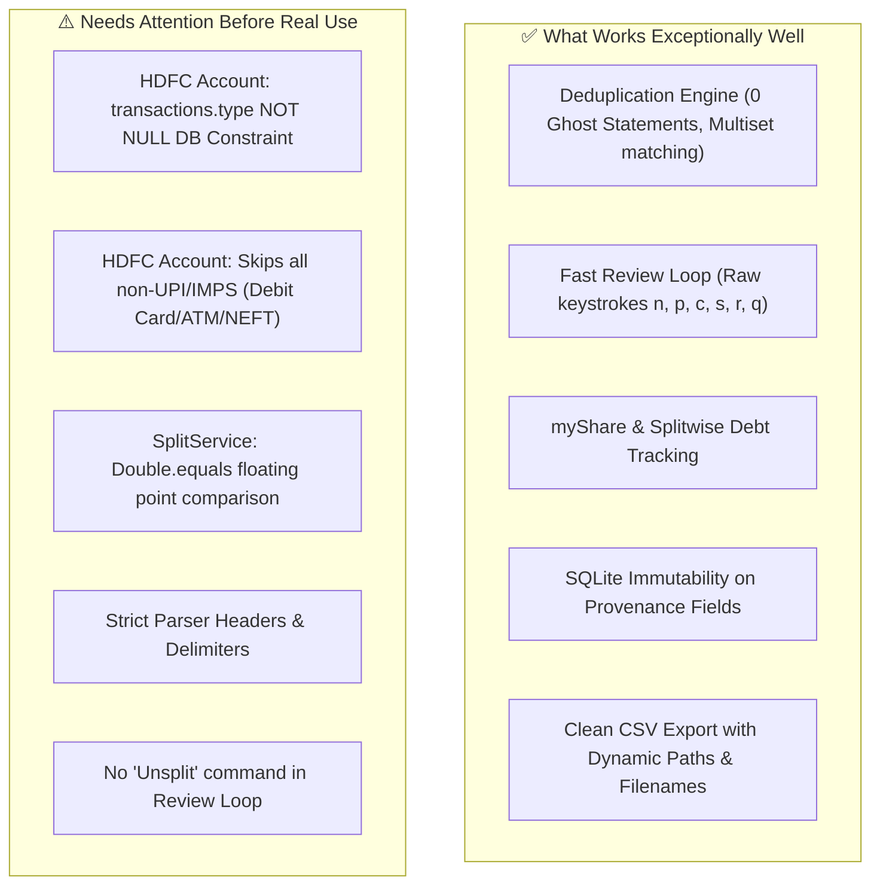

# ExpenseSimplified: Pre-Flight Application Audit & Edge-Case Report

**Author:** Antigravity Pairing Assistant  
**Date:** November 2026  
**Scope:** Full application end-to-end audit (Parsing, Deduplication, Review Workflow, Friend & Split Management, Rule Mapping, SQLite Persistence, and CSV Export).

---

## Executive Summary

Before importing real-world statements to categorize and split transactions, we conducted an exhaustive static analysis and scenario simulation across all components.

While the core architecture (two-tier deduplication, interactive JLine review navigation, SQLite schema, and `myShare` export) is well-designed and covered by 200 passing unit tests, **there are 3 critical failure risks** and several usability friction points that you need to be aware of before loading production statements.

Most notably, **importing an HDFC Account statement with unmapped transactions will crash on SQLite** due to a database constraint mismatch (`NOT NULL` constraint on `transactions.type`).

---

## 1. Showstoppers & Critical Risks

### ✅ 1. [RESOLVED] SQLite `NOT NULL` Crash on `transactions.type` for Unreviewed Account Transactions
- **Status:** Resolved in `V6__allow_null_transaction_type.sql` and `JdbcTransactionRepository`. Null values for pending transactions are fully supported.

---

### ✅ 2. [RESOLVED] Floating-Point Equality Trap in Custom & Percent Splits
- **Status:** Resolved in `SplitService`. `Double.equals` replaced with epsilon tolerance (`EPSILON = 0.01`).

---

### ✅ 3. [RESOLVED] Non-UPI / Non-IMPS Transactions in HDFC Account
- **Status:** Resolved in `HdfcAccountStatementParser`. Fallback narration parsing now captures POS, ATM, Sweep-In, NEFT/RTGS, and other narrations rather than dropping them. Date format pattern updated to `[dd/MM/yyyy][dd/MM/yy]`.

---

## 2. Parsing Fragilities & Format Sensitivities

| Component | Strict Assumption | Real-World Failure Scenario | Severity |
| :--- | :--- | :--- | :--- |
| **HDFC Account Headers** | Expects exact column `"Value Dat"` | In some HDFC Netbanking exports, the header is `"Value Date"`. If `"Value Date"` is present, `actualHeaders.equals(EXPECTED_STMT_HEADER)` throws `MalformedCsvException`. | Medium |
| **HDFC Account Dates** | Expects pattern `dd/MM/yy` (2-digit year) | If your bank statement outputs 4-digit years `dd/MM/yyyy` (e.g. `01/08/2026`), `LocalDate.parse()` throws `DateTimeParseException` and skips the row. | High |
| **HDFC CC Delimiter** | Expects `~|~` (tilde-pipe-tilde) | If you open the CSV in Microsoft Excel or Google Sheets and save it as a standard CSV (comma-separated), the parser fails to find the header prefix and aborts. Always supply the raw downloaded file. | Medium |
| **HDFC CC Loop Termination** | Breaks when `Transaction type` is not "Domestic" or "International" | If HDFC includes an interim line (e.g. EMI installment note, milestone reward note, or trailing delimiter row), line 115 executes `break;`, which stops parsing and drops all subsequent transactions in the file. | High |
| **Scapia CC Headers** | Expects exact lowercase: `date`, `time`, `description`, `amount` | If the Federal Bank / Scapia download contains Title Case (`Date`, `Time`, `Description`, `Amount`), `equals(EXPECTED_STMT_HEADER)` fails with `MalformedCsvException`. | Medium |
| **Scapia CC Date Format** | Expects `dd-MM-yyyy` (hyphens) | If the file uses `dd/MM/yyyy` (slashes), `LocalDate.parse` fails and records are skipped. | Medium |
| **UPI IFSC Requirement** | Requires 11-character bank IFSC code in UPI narration | Merchant QR transactions or newer bank narration formats that omit the IFSC code will fail `narrationTooling.extractBankIfsc()` and get skipped. | High |

---

## 3. Workflow & UX Limitations

### 1. No "Unsplit" Option
- If you split a transaction by mistake and want to revert it back to normal (unsplit), there is currently no CLI mechanism to remove splits.
- In `promptSplit`, selecting only "Myself" produces: `⚠ Need to select at least one friend (other than self) to split`.
- **Workaround:** You can only re-split it with someone else; to completely remove the split, rows must be deleted from SQLite table `transaction_splits` and `my_share` reset to `amount`.

### 2. Rule Saving Does Not Retroactively Apply to Current Statement
- Pressing `[r]` in the review loop saves the mapping rule into SQLite for future imports.
- It does **not** categorize the current transaction (you must still press `[c]`), nor does it retroactively categorize other matching transactions already loaded into the review session.

### 3. CLI Command Typo in Friend Hint
- In `StatementCommands.java:414`, the prompt displays:
  `⚠ No friends configured. Add friends using 'friend add' command`
- The actual Spring Shell command is `friend-add` (hyphenated). Typing `friend add` returns a syntax error.

### 4. Unknown Instrument Error Message
- If you pass an instrument identifier not in `instruments.yml` (e.g. typing `scapia` instead of `scapia-cc`), the CLI reports:
  `Error: statement type could not be determined`
  without listing the available configured instruments (`hdfc-sal-acc`, `hdfc-cc-mil`, `scapia-cc`).

### 5. Export Only Includes Reviewed Transactions
- If you import 40 transactions, review 10, and run `export -s <id>`, the output CSV will contain **only the 10 reviewed transactions**.
- `PENDING` transactions are intentionally excluded from CSV export. If you expect all transactions in the export, you must review them first.

---

## 4. Summary Matrix: Where the App Succeeds vs Falls Short

---

## 5. Recommended Action Plan

Before running your full statements:

1. **Fix `transactions.type` SQLite constraint (Immediate):**
   Add a Flyway migration `V6__allow_null_transaction_type.sql` to make `type` nullable in `transactions`, allowing unreviewed account transactions to be saved.
2. **Add a Fallback Narration Parser for HDFC Account (Immediate):**
   Add a generic fallback parser (or update `HdfcAccountStatementParser`) so that debit card purchases, ATM withdrawals, and bank fees are captured with `mode = DEBIT_CARD / OTHER` and `counterparty = narration`, instead of being dropped.
3. **Change Double equality to delta in `SplitService` (Immediate):**
   Change `!percentSum.equals(100.0)` to `Math.abs(percentSum - 100.0) > 0.01` and similarly for `sum.equals(amount)`.
4. **Configure Friends first:**
   Run `friend-add -n <FriendName>` before launching `review`, so you can immediately split transactions without exiting the review loop.
